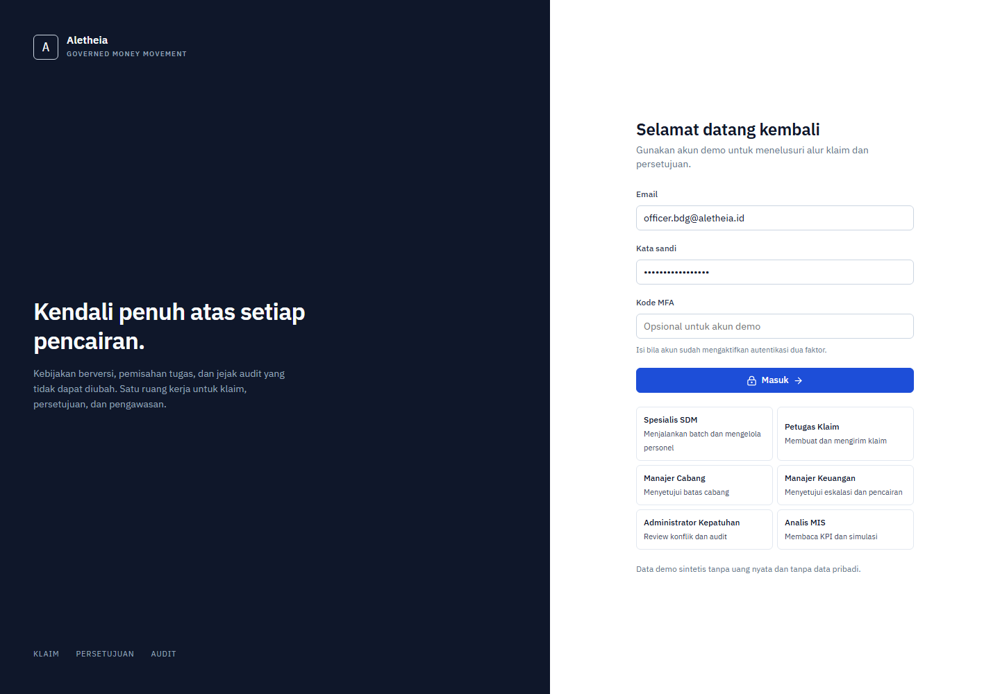
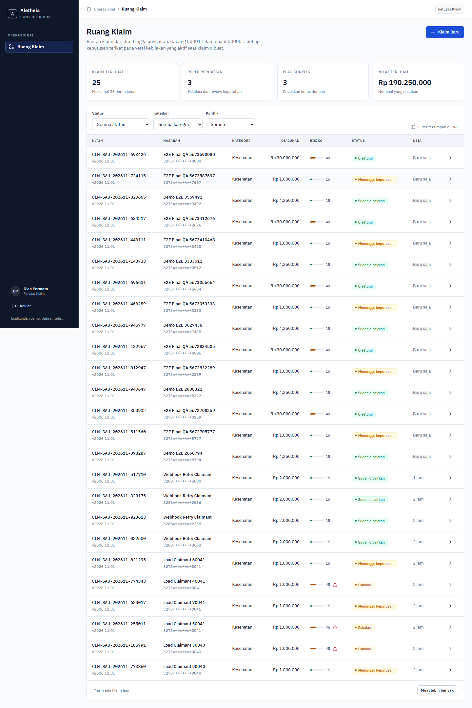
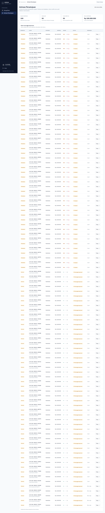
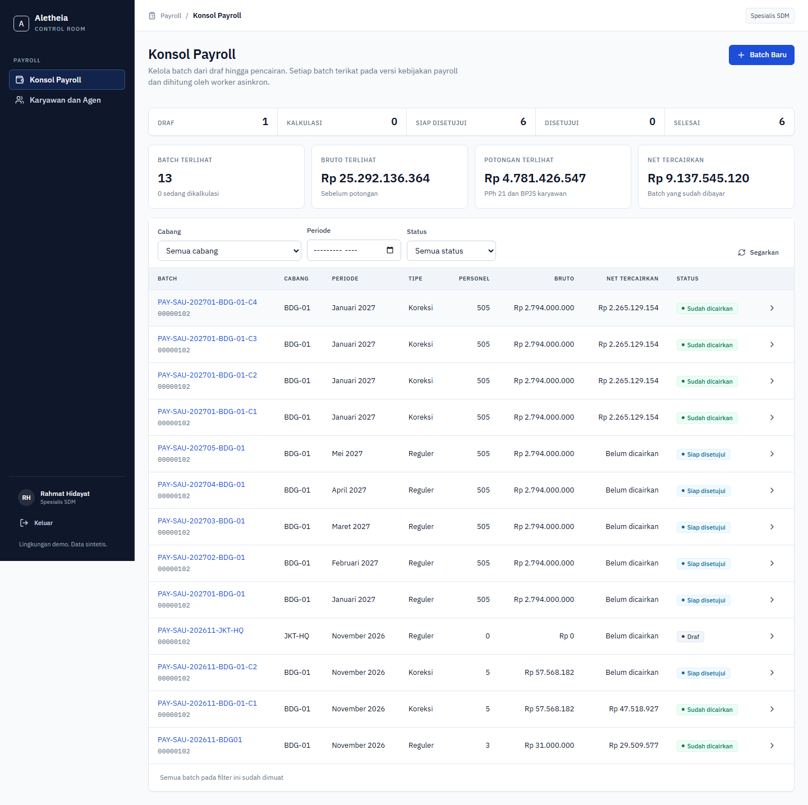
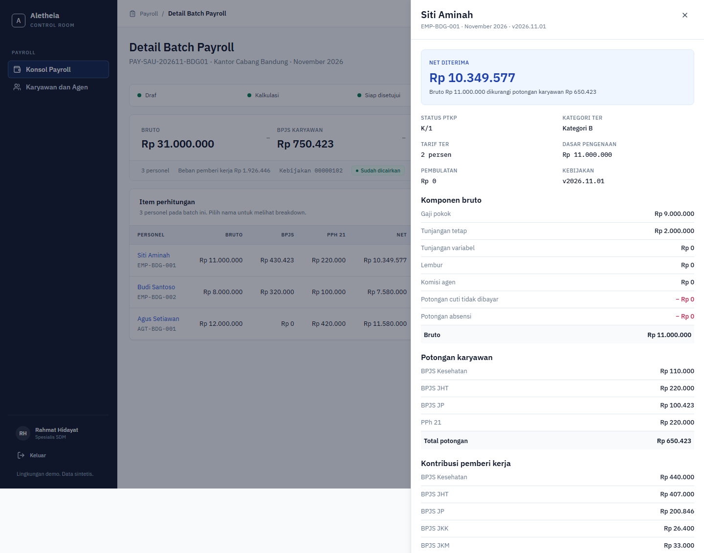
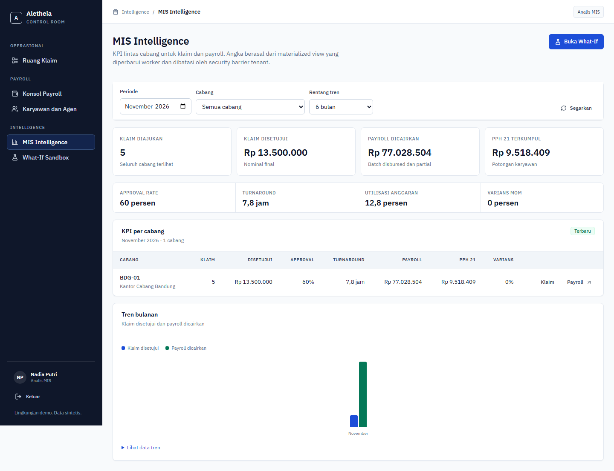
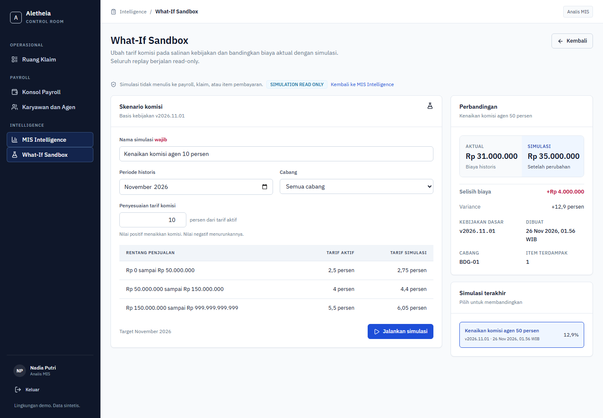
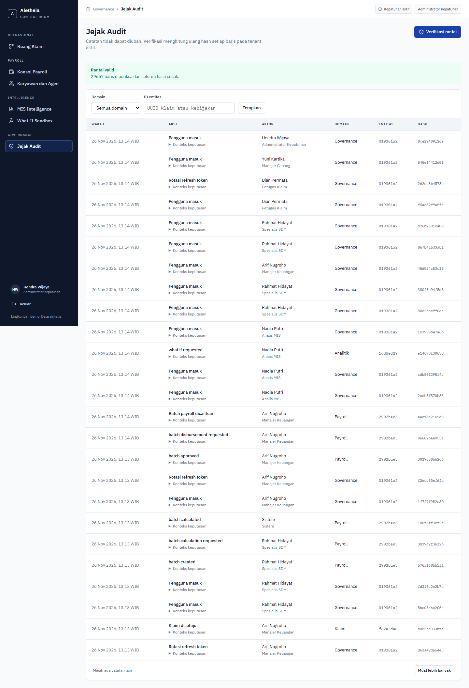
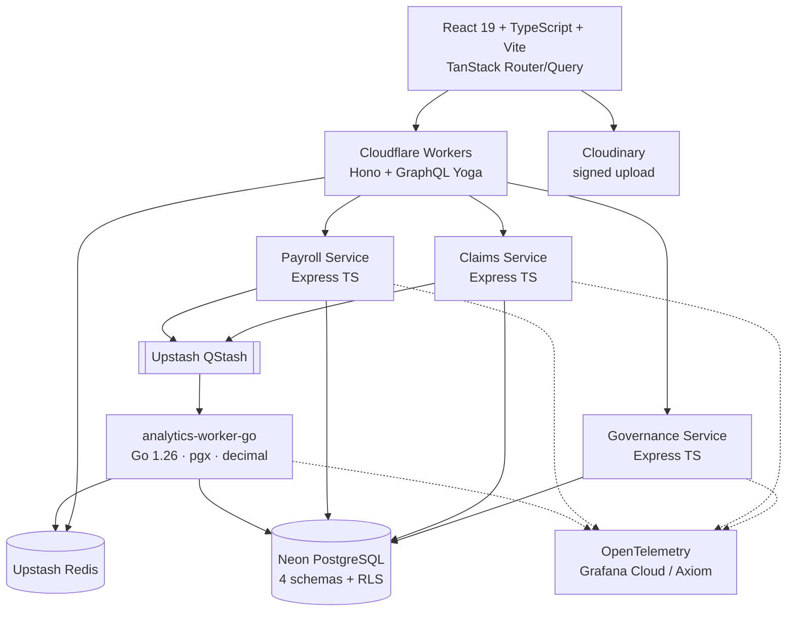

# Aletheia

**Enterprise Disbursement Governance & MIS Intelligence Platform**

Aletheia (Greek: *unconcealment*) is a reference implementation for governed money movement: customer claims, payroll, agent commissions, tax withholding, and cross-domain risk intelligence — built around **versioned policy references**, **zero double-disbursement**, and an **immutable audit trail**.

> **Status:** M1–M5.4 live di production. Web, edge, empat service Render, Neon, Upstash QStash, dan Cloudinary aktif; smoke production **15/15 lulus**, async QStash/worker terverifikasi, login enam peran dan UI web terverifikasi, serta rollback edge, Pages, dan Render diuji. M6.1 portofolio siap (README, 8 screenshot, video 2:16, CHANGELOG). M6.2 live dengan monitoring 24 jam berjalan via `.github/workflows/production-monitor.yml`. Render free tier memiliki cold start; jalankan `pnpm warm:production` sebelum demo. Baca [`HANDOVER.md`](HANDOVER.md) sebelum melanjutkan.

## Why this exists

Most finance/HR systems hardcode approval limits, tax rates, and commission formulas. That makes them brittle: a new regulation requires a code change, and historical transactions lose their legal context.

Aletheia separates:

1. **Mutable business policy** — approval tiers, tax/BPJS parameters, commission tiers, risk weights — stored as versioned `rules_payload` JSONB. Every transaction binds to the policy version that was active when it was created.
2. **Non-negotiable invariants** — accurate PPh 21/BPJS math, no double disbursement under any concurrency, append-only audit, maker ≠ checker, tenant isolation.

## Capabilities

- **Claims operations** — submission, document upload, risk scoring, tiered approval/escalation, disbursement.
- **Payroll & incentives** — employee/agent master, attendance/leave summary, payroll console, batch calculation, breakdown, variance, approval, disbursement, PPh 21 TER, BPJS employee/employer, agent commission tiers.
- **HRIS-lite** — payslip PDF, PPh 21 monthly and annual reports, BPJS reports, bank transfer files, payroll variance, annual reconciliation.
- **MIS intelligence** — cross-branch KPIs, tren, materialized views, cache dan invalidasi, What-If policy simulation read-only melalui GraphQL.
- **Governance** — versioned policies with checksums, RBAC, segregation of duties, hash-chained audit, tenant-ready schema.
- **Payments** — provider-agnostic adapter, idempotent webhook, reversal, retry with attempt numbers, and a mock provider for demos.

## Screenshots

| Login dan akun demo | Workbench klaim |
| --- | --- |
|  |  |
| **Antrean persetujuan** | **Konsol payroll** |
|  |  |
| **Breakdown PPh 21 / BPJS** | **MIS intelligence** |
|  |  |
| **What-If sandbox** | **Jejak audit** |
|  |  |

Mobile: [`claims`](docs/evidence/m6.1/mobile-claims.png) · [`payroll`](docs/evidence/m6.1/mobile-payroll.png) · [`MIS`](docs/evidence/m6.1/mobile-mis.png). Semua data sintetis. Indeks lengkap ada di [`docs/evidence/m6.1/screenshots.md`](docs/evidence/m6.1/screenshots.md).

## Demo video

[Tonton walkthrough 2:16](docs/evidence/m6.1/aletheia-demo.webm) — login, klaim, approval/SoD, payroll dan breakdown, MIS/What-If, serta verifikasi audit chain. Rekaman dibuat dengan `pnpm demo:record` saat stack lokal hidup; skripnya ada di `scripts/record-demo.mjs`.

## Architecture



**Monorepo, independently deployed.** One repository (`apps/*`, `services/*`, `packages/*`), separate deploy pipelines for Cloudflare Pages, Cloudflare Workers, and container hosts. See `docs/12-delivery-repo-and-portfolio-strategy.md`.

## Stack

| Layer | Technology |
| --- | --- |
| Frontend | React 19, TypeScript, Vite, TanStack Router, TanStack Query, Tailwind CSS |
| Edge | Cloudflare Workers, Hono, GraphQL Yoga |
| Services | Express.js (TypeScript), Go 1.26 worker |
| Data | Neon PostgreSQL 16, Drizzle ORM, `pgx/v5` |
| Cache/Queue | Upstash Redis, Upstash QStash |
| Media | Cloudinary signed uploads |
| Observability | OpenTelemetry, Grafana Cloud/Axiom, k6 |
| Delivery | pnpm workspace, Docker multi-stage, GitHub Actions, Nginx |

## Documentation

| Doc | Contents |
| --- | --- |
| [`00-context-and-vision.md`](docs/00-context-and-vision.md) | Philosophy, pillars, roles, invariants |
| [`01-architecture-and-infra.md`](docs/01-architecture-and-infra.md) | Topology, free-tier constraints, repo layout |
| [`02-database-and-governance.md`](docs/02-database-and-governance.md) | Schemas, indexes, RLS, audit trigger |
| [`03-api-and-graphql-contracts.md`](docs/03-api-and-graphql-contracts.md) | REST/GraphQL contracts, errors, idempotency |
| [`04-business-rules-and-engines.md`](docs/04-business-rules-and-engines.md) | PPh 21, BPJS, commission, risk, What-If |
| [`05-devops-and-verification.md`](docs/05-devops-and-verification.md) | Docker, CI/CD, observability, test gates |
| [`06-execution-roadmap.md`](docs/06-execution-roadmap.md) | Phased execution plan |
| [`07-frontend-architecture-and-ux.md`](docs/07-frontend-architecture-and-ux.md) | Screens, design system, accessibility |
| [`08-security-and-compliance.md`](docs/08-security-and-compliance.md) | Threat model, RLS, PII, OWASP ASVS |
| [`09-observability-and-performance.md`](docs/09-observability-and-performance.md) | SLOs, metrics, k6, runbooks |
| [`10-testing-and-quality-strategy.md`](docs/10-testing-and-quality-strategy.md) | Test pyramid, gates, evidence |
| [`11-hris-lite-and-payroll-reporting.md`](docs/11-hris-lite-and-payroll-reporting.md) | Payslips, PPh 21/BPJS reports, HRIS-lite |
| [`12-delivery-repo-and-portfolio-strategy.md`](docs/12-delivery-repo-and-portfolio-strategy.md) | Repo decision, FE/BE order, portfolio packaging |
| [`13-job-targeting-matrix.md`](docs/13-job-targeting-matrix.md) | 100%+ mapping to two target job posts |
| [`13a-job-posts.md`](docs/13a-job-posts.md) | Requirement registry with stable IDs |
| [`14-architecture-decision-records.md`](docs/14-architecture-decision-records.md) | ADR-001..018 with trade-offs |
| [`15-audit-fix-register.md`](docs/15-audit-fix-register.md) | Audit findings, fixes, remaining risks |
| [`16-milestone-phase-plan.md`](docs/16-milestone-phase-plan.md) | 7 milestone, 19 fase, deployment free-tier |
| [`CHANGELOG.md`](CHANGELOG.md) | Riwayat rilis dan perubahan |
| [`docs/evidence/m6.1-verification.md`](docs/evidence/m6.1-verification.md) | Verifikasi portofolio M6.1 |
| [`docs/runbooks/m6.2-launch.md`](docs/runbooks/m6.2-launch.md) | Runbook launch, smoke, rollback, monitoring M6.2 |
| [`docs/evidence/m6.2-verification.md`](docs/evidence/m6.2-verification.md) | Bukti smoke production, web UI, rollback edge/Pages/Render, cold start, monitoring |

## Getting started

Satu perintah untuk menyalakan PostgreSQL, migrasi, seed, seluruh service, worker, edge, web, dan observability:

```bash
bash scripts/dev-up.sh
```

Hentikan semuanya tanpa menghapus data:

```bash
bash scripts/dev-down.sh
```

Panduan lengkap, akun, port, troubleshooting, dan batasan ada di [`HANDOVER.md`](HANDOVER.md).

Verifikasi:

```bash
pnpm verify
pnpm test:coverage
pnpm test:a11y
pnpm test:e2e
```

`pnpm test:e2e` memerlukan stack lokal. Untuk alur payroll lengkap, set `RUN_FULL_E2E=1`.

Web tersedia di `http://localhost:5173`, edge di `http://127.0.0.1:8787`. Web mem-proxy `/api` dan `/graphql` ke edge, sehingga cookie refresh tetap same-origin saat development.

## Demo accounts

Kata sandi semua akun: **`AletheiaDemo!2026`**. MFA nonaktif pada demo.

| Email | Role | Tenant | Cabang |
| --- | --- | --- | --- |
| `officer.bdg@aletheia.id` | CLAIMS_OFFICER | SAU | BDG-01 |
| `manager.bdg@aletheia.id` | BRANCH_MANAGER | SAU | BDG-01 |
| `finance.vp@aletheia.id` | FINANCE_MANAGER | SAU | JKT-HQ |
| `hr.ops@aletheia.id` | HR_SPECIALIST | SAU | JKT-HQ |
| `compliance@aletheia.id` | COMPLIANCE_ADMIN | SAU | JKT-HQ |
| `mis.analyst@aletheia.id` | MIS_ANALYST | SAU | JKT-HQ |
| `compliance@bpui.id` | COMPLIANCE_ADMIN | BPUI | JKT-HQ |

Halaman login menyediakan tombol peran demo yang mengisi email dan kata sandi otomatis. Untuk alur < 3 menit: jalankan `bash scripts/dev-up.sh`, buka `http://localhost:5173`, pilih **Spesialis SDM** untuk payroll atau **Petugas Klaim** untuk klaim, lalu jelajahi menu sesuai peran.

## Live production

- Web: [aletheia-web-preview.pages.dev](https://aletheia-web-preview.pages.dev)
- Edge: [aletheia-edge.ridwanafzn.workers.dev](https://aletheia-edge.ridwanafzn.workers.dev)
- Governance: [aletheia-governance.onrender.com](https://aletheia-governance.onrender.com)
- Claims: [aletheia-claims.onrender.com](https://aletheia-claims.onrender.com)
- Payroll: [aletheia-payroll.onrender.com](https://aletheia-payroll.onrender.com)
- Worker: [aletheia-worker-zjnt.onrender.com](https://aletheia-worker-zjnt.onrender.com)
- Neon production: project `aletheia` (PG16, Singapore), migrasi 0000–0011, RLS 36/36.
- Upstash QStash dan Cloudinary aktif.

Web production menyajikan CSP, HSTS, COOP, dan Permissions-Policy. Render free tier tidur saat idle; cold start bisa lebih dari 2 menit. Sebelum demo:

```bash
pnpm warm:production
```

Lalu buka web production dan masuk dengan akun demo di atas. Uji async QStash/worker dengan `pnpm async:production`. Monitoring production berjalan setiap 6 jam lewat workflow **Production Monitor**; baseline `45816325368` dan run pasca-drill `45821314200` lulus dengan smoke 15/15. Untuk stack lokal, gunakan `bash scripts/dev-up.sh` dan `http://localhost:5173`.

Semua endpoint selain health, login, refresh, dan webhook payment memerlukan header bertanda tangan gateway. Produksi wajib mengisi `INTERNAL_GATEWAY_SECRET`, `JWT_PRIVATE_KEY`, `JWT_PUBLIC_KEY`, `REFRESH_TOKEN_PEPPER`, `MFA_ENCRYPTION_KEY`, `PII_PEPPER`, kredensial Cloudinary, `PAYMENT_WEBHOOK_SECRET`, dan `FILE_SIGNING_SECRET`.

Payroll Console mencakup daftar batch, pembuatan batch, progres kalkulasi, rincian komponen per personel, varians, persetujuan, dan pencairan. Employee Directory menampilkan profil personel, rekening masked, ringkasan absensi, dan riwayat cuti. Go worker mengisi kalkulasi PPh 21 TER, BPJS karyawan dan pemberi kerja, komisi agen, anomali klaim, What-If read-only, dan refresh KPI. QStash production sudah aktif; `WORKER_URL` disinkronkan ke URL worker Render yang sebenarnya sebelum uji async final.

## Testing

```bash
pnpm test
pnpm test:coverage
pnpm test:a11y
pnpm test:e2e
RUN_FULL_E2E=1 pnpm test:e2e
```

`test:coverage` menegakkan threshold domain 90% lines, 90% statements, 90% functions, dan 85% branches. Hasil M5.3: 96,26% lines. `test:e2e` memerlukan web, edge, service, worker, dan PostgreSQL lokal. `RUN_FULL_E2E=1` mengaktifkan alur kalkulasi dan pencairan payroll.

## Security gates

```bash
pnpm security:db
pnpm security:audit
pnpm security:pii
pnpm security:deps
```

`security:db` memeriksa RLS, policy, role aplikasi, privilege audit, dan probe tanpa tenant. `security:audit` memverifikasi hash chain per tenant. `security:pii` memindai source untuk NIK atau rekening mentah. Gitleaks, Semgrep, Trivy, dan govulncheck dijalankan melalui workflow `.github/workflows/security.yml`.

## Observability

```bash
docker compose --profile observability up -d otel-collector jaeger prometheus grafana
pnpm load:seed
pnpm load:smoke
```

* Grafana: `http://localhost:3000`
* Jaeger: `http://localhost:16686`
* Prometheus: `http://localhost:9090`

Dashboard dan alert disimpan di `infra/observability/`. Bukti M5.2 ada di `docs/evidence/m5.2-verification.md` dan `docs/evidence/load/`.

## Agents & skills

- **Primary agent:** `.opencode/agents/aletheia-lead.md`
- **Specialists:** `architect`, `database-engineer`, `backend-engineer`, `frontend-engineer`, `security-auditor`, `qa-engineer`, `finance-reviewer`, `devops-engineer`
- **Finance skill:** `.opencode/skills/aletheia-finance/SKILL.md`
- **Installed skills:** `impeccable` (design), `karpathy-guidelines` (coding discipline), `superpowers` (15 workflow skills: brainstorming, TDD, debugging, planning, review, verification), `payroll-prep`, `plan-payroll` (reference workflows; US/Gusto-oriented), plus `cash-flow-snapshot` and `invoice-chase` dependencies.

> `payroll-prep`/`plan-payroll` are reference workflows, not Indonesian compliance sources. PPh 21/BPJS rules for Aletheia live in `aletheia-finance`, `docs/04`, and `docs/11`.

## Roadmap

| Phase | Outcome | Status |
| --- | --- | --- |
| 0 | Docs, ADRs, agents, skills, design refs | done |
| 1 | Monorepo, tooling, Docker, CI, shared contracts, schema | done: M1.1, M1.2, M1.3 |
| 2 | Claims vertical slice | done: M2.1, M2.2, M2.3 |
| 3 | Payroll + HRIS-lite | done: M3.1–M3.4 |
| 4 | MIS + GraphQL BFF | done: M4.1 dan M4.2 |
| 5 | Hardening: RLS audit, observability, load, security, E2E | done: M5.1–M5.4 live di Render, Neon, Cloudflare, Upstash, Cloudinary |
| 6 | Portfolio: deploy, README, video, evidence | in progress: M6.1 selesai; M6.2 live, rollback edge/Pages/Render lulus, monitoring 24 jam berjalan; sign-off setelah 4 run |

See [`docs/06-execution-roadmap.md`](docs/06-execution-roadmap.md) for task-level detail.

## Design references

- [`PRODUCT.md`](PRODUCT.md) — product context, users, workflows, success metrics.
- [`DESIGN.md`](DESIGN.md) — design principles, tokens, components, screen patterns.

## Contributing

This is a solo portfolio project, but the workflow is documented in [`CONTRIBUTING.md`](CONTRIBUTING.md): branch naming, conventional commits, PR template, testing gates, ADR, and security rules.

## License

GPL-3.0. See [`LICENSE`](LICENSE).

## Disclaimer

This is a portfolio/reference project. Tax and BPJS parameters are policy-driven examples and must be verified with a qualified tax consultant before any real-world use. All demo data is synthetic.
